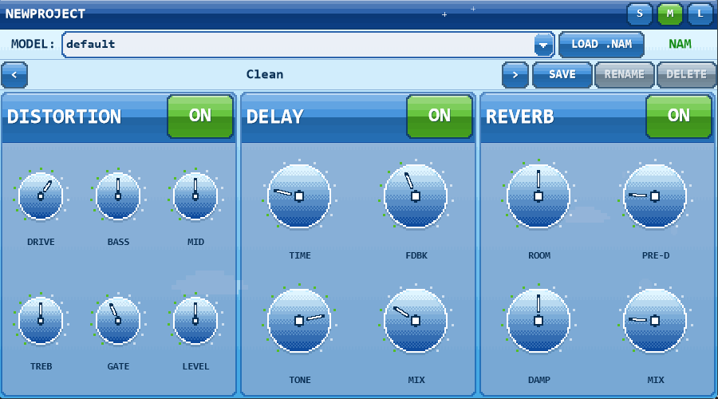

# Amp-Plugin-Project

**A neural guitar amp sim with an early-2000s pixel-art soul.**

Amp-Plugin-Project is a JUCE-based guitar amplifier plugin (VST3 + Standalone) built around
[Neural Amp Modeler (NAM)](https://www.neuralampmodeler.com/) — load any `.nam` capture and play it
through a full pedalboard-style chain, wrapped in a custom **"Pixel Aero"** interface: Frutiger Aero
gloss rendered entirely in chunky pixel art.



## Features

- **NAM neural amp modeling** — loads standard WaveNet / LSTM / ConvNet `.nam` model files
  (v0.5.x format). Models are managed in a persistent library folder; import via the
  **LOAD .NAM** button or just **drag & drop** a `.nam` file onto the plugin window.
- **Fallback distortion** — if no model is loaded, a built-in high-gain waveshaper keeps the
  signal chain audible. The status indicator shows `NAM` (green) when the neural engine is
  active, `FALLBACK` (red) when it isn't — hover it to see the exact load error.
- **Signal chain** — noise gate → pre-EQ → NAM inference → 3-band tone stack →
  cabinet simulation (SM57 on a 4x12 V30 voicing) → delay → reverb.
- **Preset system** — factory + user presets with save / rename / delete.
- **Pixel Aero UI** — dithered sky gradients, frosted-glass panels, glossy aqua orb knobs with
  value ticks, capsule buttons, pixel clouds and sparkles. No smooth gradients anywhere:
  everything is drawn on a virtual pixel grid with ordered dithering, and it scales across
  three window sizes (S / M / L).

## Repository Structure

| Path | Contents |
|------|----------|
| `Source/` | Plugin code: processor, editor, preset manager, Pixel Aero look & feel |
| `Source/NAM/` | Bundled NAM core (WaveNet, LSTM, ConvNet, slimmable WaveNet) |
| `Dependencies/eigen/` | Eigen headers (vendored so Windows builds work out of the box) |
| `Models/` | Starter `.nam` models, copied to your model library on first run |
| `CMakeLists.txt` / `NewProject.jucer` | CMake and Projucer build configurations |

## Building

### Prerequisites

- [JUCE](https://juce.com/) 8.x source tree
- A C++17 compiler (MSVC, Clang, or GCC)
- CMake 3.22+ (for the CMake workflow)

### CMake

```bash
cmake -B build -DJUCE_PATH="/path/to/JUCE"
cmake --build build --config Release
```

If `JUCE_PATH` is omitted, the build looks for JUCE at `../../JUCE`, `../JUCE`, and `./JUCE`.
This produces both the **VST3** and a **Standalone** app under `build/NewProject_artefacts/Release/`.
Copy the `.vst3` folder to your system VST3 directory (e.g. `C:\Program Files\Common Files\VST3`
on Windows) and rescan in your DAW.

### Projucer

1. Open `NewProject.jucer` in Projucer.
2. Select your IDE exporter and "Save and Open in IDE".
3. Build the VST3 target.

## Model Library

On first run the plugin creates a model library folder and seeds it with the bundled models:

- **Windows:** `%APPDATA%\NewProject\Models`
- **macOS:** `~/Library/Application Support/NewProject/Models`

Any `.nam` file you import lands there and appears in the model dropdown.

## Changelog

### 2026-07-16 — Pixel Aero UI
- Complete visual redesign: dithered sky background with pixel clouds, bubbles, and sparkles;
  frosted-glass effect panels; glossy deep-blue title bar.
- New glossy aqua orb knobs with pixel-stepped edges, quantised gloss caps, and green value
  ticks around the rim.
- Two-row knob grids per panel — knobs are roughly twice as large as before.
- Model load errors are now visible: hover the `ERR:` / `FALLBACK` indicator for the full message.

### 2026-07-15 — NAM loading fix & build improvements
- **Fixed NAM models failing to load in plugin builds** (`No config parser registered for
  architecture: WaveNet`): the architecture registry relied on static initializers that the
  linker strips when NAM is built into a static library. Architectures are now registered
  explicitly on first use.
- JUCE location is configurable via `-DJUCE_PATH` instead of a hardcoded relative path.
- Added a Standalone build target for testing without a DAW.

### Earlier
- NAM core integration with cross-platform model discovery and Unicode path handling.
- Cabinet simulation (SM57 / 4x12 V30 voicing), cascaded-gain-stage fallback distortion,
  noise gate, tone stack, delay, and reverb.
- Preset system, drag-and-drop model import, resizable UI.

## License

[MIT](LICENSE) © kaanceran
