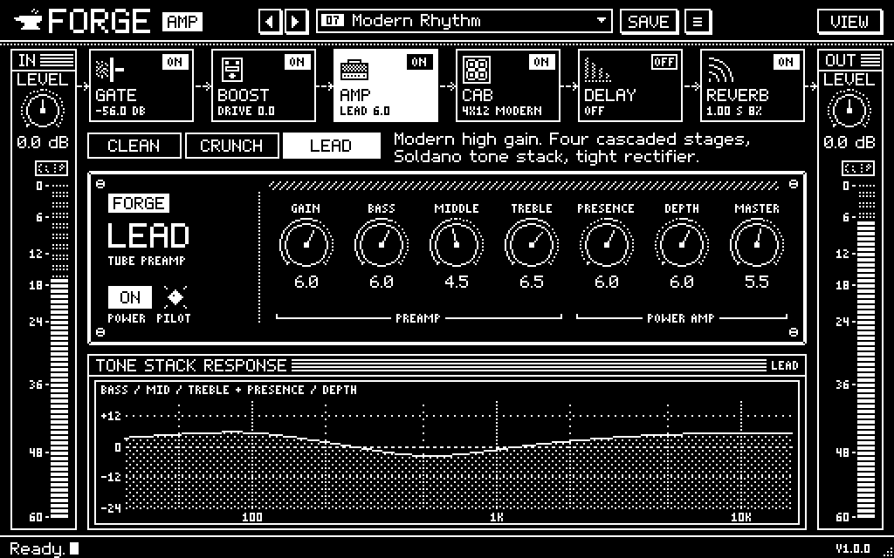
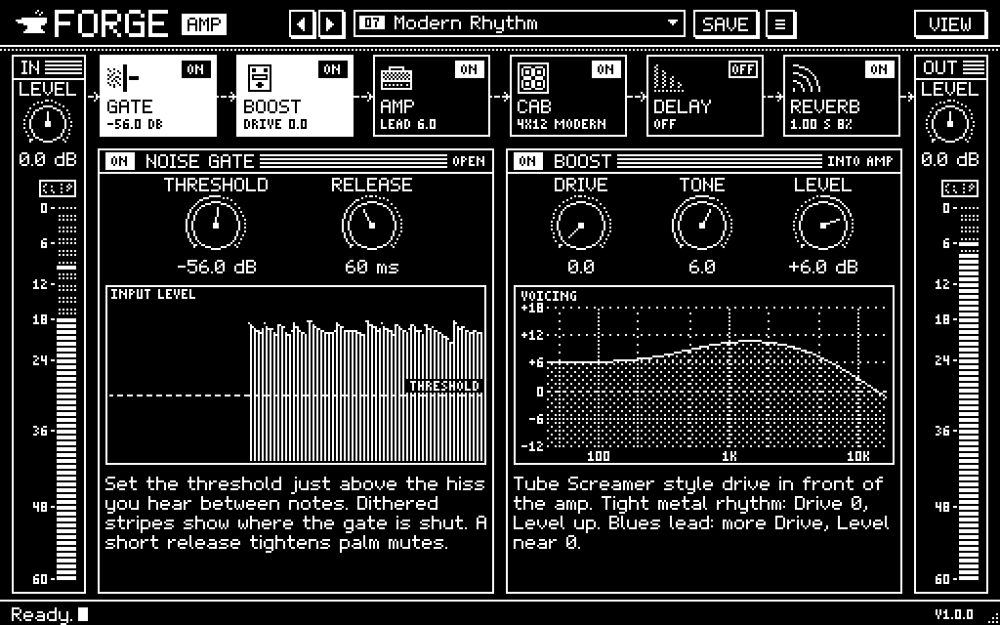
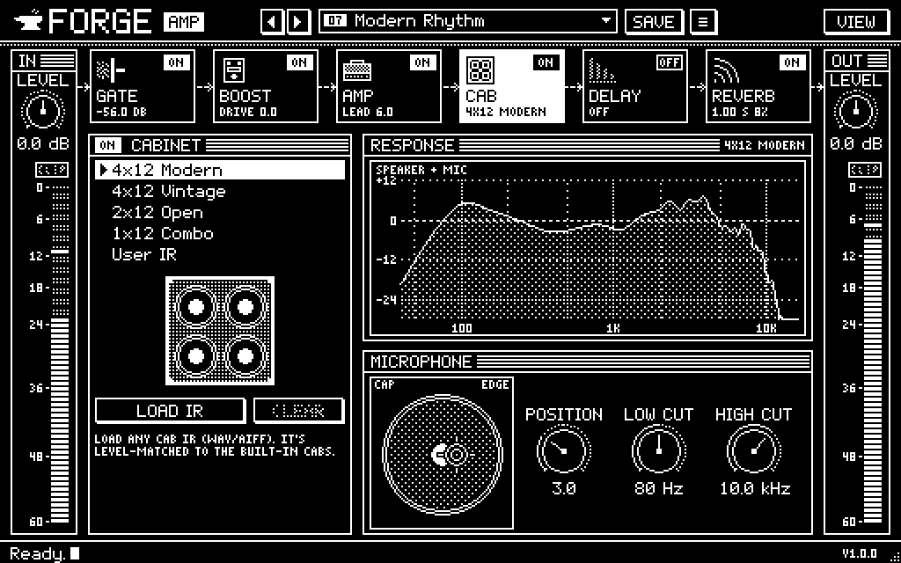
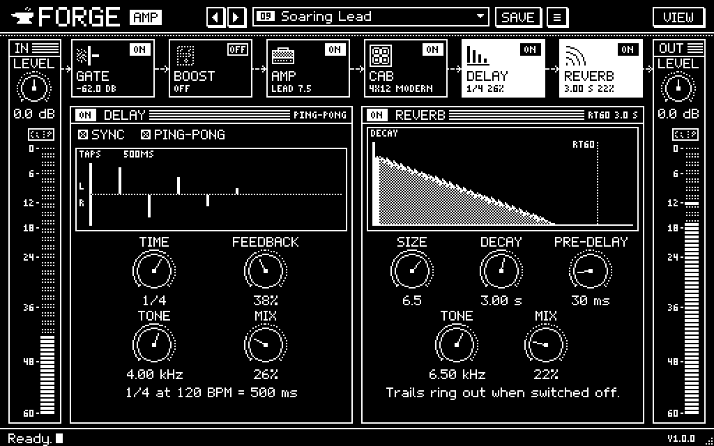

# Forge Amp

A guitar amp simulator plugin (VST3 / AU / Standalone) built with JUCE 9 and C++17.
It has three tube-amp voices modelled on real circuits, a Tube Screamer-style boost, a noise gate,
speaker cabinets with impulse-response loading, a tempo-synced delay and a feedback-delay-network
reverb. The interface is 1-bit pixel art in the black-and-white, early-2000s style of the original
project, drawn crisp at any window size.



| Pre-amp pedals | Cabinet | Effects |
|---|---|---|
|  |  |  |

## Download

Windows builds are on the [Releases page](https://github.com/kaancer33/Amp-Plugin-Project/releases).
Unzip, then copy `Forge Amp.vst3` to `C:\Program Files\Common Files\VST3` and rescan plugins in
your DAW, or run `Forge Amp.exe` on its own.

---

## The interface

The whole UI is drawn on a 512 x 320 canvas of black and white "art pixels", then zoomed to the
window:

- **Bitmap fonts.** It uses a hand-drawn 5x7 font with lower case and descenders, a 3x5 font for
  small print, and the 5x7 font doubled for headings. No system fonts and no anti-aliasing.
- **Dithering instead of greys.** Checkerboard, dot, line and weave patterns do the shading.
  Bypassed controls get the classic dithered "greyed out" look on their dials.
- **Windows.** Every module is a window with a striped title bar and the original ON/OFF box.
- **Pixel art.**
  - The signal chain has icons, and dots run along its wires while audio plays.
  - The amp faceplate has screws, a vent, a jewel pilot light and silk-screened PREAMP and
    POWER AMP groups.
  - Each cabinet is drawn on screen.
  - The mic is a crosshair that moves across the speaker with the Position knob.
  - The delay shows its taps (left/right in ping-pong). The reverb shows its decay ramp down to
    the RT60 marker.
- **Status bar.** The bar at the bottom explains whatever is under the mouse, like the status line
  of a 2000s desktop app.
- **Crisp at every size.** The canvas is rendered once at its own resolution and scaled up by the
  largest whole factor with nearest neighbour. Any remaining fractional zoom (or Windows display
  scaling) is one linear pass. At 1x, 2x, 3x and 4x every art pixel is an exact block of screen
  pixels, and the test harness checks that. Popup menus and dialogs open inside the canvas, so they
  scale the same way.

## Signal flow

```
input gain ─► noise gate ─► ┌──────────── 4x oversampled ────────────┐ ─► cabinet ─► delay ─► reverb ─► output gain
                            │ boost ─► preamp stages ─► tone stack ─► │    (model     (stereo, (stereo
                            │          power amp (presence, depth, sag)│     or IR)    trails)  FDN)
                            └────────────────────────────────────────┘
        mono guitar chain, like a real rig                                        stereo effects
```

Every module can be switched off with a click-free crossfade. Latency is 6 samples and stays
the same whether modules are on or off, so the host can compensate exactly.

## How the sound is built

Each choice below follows published work or the behaviour of the original circuit.

**Tone stack.** It uses the exact 3rd-order transfer function of the passive treble/middle/bass
network ("FMV" stack), derived by D. T. Yeh and J. O. Smith in *Discretization of the '59 Fender
Bassman Tone Stack* (DAFx-06) and discretised with the bilinear transform. The knobs interact the
way they do on the real amp. Component values are the measured sets collected by the Guitarix
project: Twin Reverb, JCM800 and Soldano SLO-100. The filter runs in double precision because a
direct-form 3rd-order filter with poles near DC isn't stable enough in float at oversampled rates.
The test harness checks the digital filter against the analog formula to within 0.005 dB.

**Preamp.** Each 12AX7 stage is a Wiener-Hammerstein block:
- A coupling-cap high-pass, then gain, then an *asymmetric, inverting* saturator, then a
  Miller-capacitance low-pass.
- Positive grid swings compress early (grid conduction). Negative swings have more headroom
  and then cut off harder.
- Because every stage inverts, the asymmetry alternates through the cascade, as on a real
  preamp. The DC it creates shifts the next stage's bias under heavy playing, which gives the
  compression and "bloom".

Each voice uses the topology of its namesake: the number of stages, where the gain pot and the
tone stack sit, coupling-cap tightness and the bright cap.

| Voice | Modelled on | Stages | Tone stack | Character |
|---|---|---|---|---|
| Clean | Fender Twin Reverb | 2 | after V1 (Fender layout) | sparkly, tube-rectifier sag |
| Crunch | Marshall JCM800 2203 | 3 | after the gain stages | mid-forward, bright cap, tight bass |
| Lead | Soldano SLO-100 / modern high gain | 4 | after the gain stages | saturated, tight solid-state rectifier |

**Power amp.** Presence and depth shape what drives the push-pull pair, as they do inside the
negative-feedback loop. A power-supply sag model lets loud passages droop and recover. Voices with
a tube rectifier sag more.

**Oversampling.** The boost and the whole amp run at 4x through low-latency polyphase IIR filters
with integer latency. Each stage's Miller low-pass band-limits what the next stage sees, so
aliasing stays about 45 dB below the harmonics even with a 3 kHz tone at full gain.

**Gain staging.** The Gain knob is partly level-compensated, so it mostly changes distortion and
Master sets the volume. All three voices sit within 0.2 dB of each other at noon.

**Boost.** Models the TS808 clipping stage:
- The clean signal passes at unity.
- The band above about 720 Hz (4.7 kΩ / 47 nF) is amplified by (51 kΩ + drive) / 4.7 kΩ and
  soft-clipped by the diodes.
- The 51 pF feedback cap rolls the gain off.

The result is the classic mid hump that tightens a high-gain amp.

**Cabinets.** There are four built-in speaker/mic models: 4x12 Modern, 4x12 Vintage, 2x12 Open
and 1x12 Combo. Each is built from:
- box resonance and box dip
- cone-breakup peaks and notches
- steep roll-off
- two short reflections, which give the comb-like ripple of real cab IRs

You can also load any WAV/AIFF cab impulse response. It is trimmed, folded to mono and
level-matched to the built-in cabs. Mic position, low cut and high cut work on both.

**Noise gate.** It uses a peak-envelope detector with open/close hysteresis and a hold time, so
it doesn't chatter on decaying notes.

**Delay.** It has stereo and ping-pong modes and syncs to the host tempo (straight, dotted and
triplet values). The feedback loop is filtered and softly saturated, with slight modulation and a
tape-like glide when the time changes. Switching it off lets the repeats ring out (trails).

**Reverb.** An 8-channel feedback delay network after Geraint Luff's *Let's Write a Reverb*
(Signalsmith Audio, ADC 2021):
- Four diffusion steps (random delays, polarity flips, Hadamard mixing).
- Modulated feedback lines with Householder mixing and damping.
- Per-line decay gains, so RT60 is exact at any size.

It replaces JUCE's Freeverb, whose comb filters ring metallically on guitar.

## Using it

- **Signal-chain strip.** Each tile shows a module's state and main setting. Click a tile to
  open its page, or its ON/OFF box to switch it. The open page's tiles are shown inverted.
- **Status bar.** Hover over anything to see what it does.
- **Knobs.**
  - Drag to turn, and hold Shift for fine control.
  - Double-click a knob to reset it.
  - Double-click the value under a knob to type a number. Units are understood, such as `2.5k`,
    `1.2 s` or `-6`.
- **Input.** Set the Input knob so the meter peaks around -12 to -6 dB. Presets never change
  this, because it calibrates the rig to your guitar and interface.
- **Presets.**
  - ◀ ▶ step through the presets, and the name opens the full list.
  - A new instance starts on **00 Default**, the parameter defaults.
  - An **EDITED** tag shows when the sound differs from the saved preset.
  - Save stores user presets in `Documents/Forge Amp/Presets`.
  - Deleting a preset moves it to the trash.
  - The current preset is remembered with your DAW session.
- **Zoom.** Drag the corner to resize, or pick 1x to 4x from **View** (2x, 1024 x 640, is the
  default). The zoom is remembered with the session.
- **Gate page.** It plots your input against the threshold and shades the moments the gate is
  closed.
- **Amp and Cab pages.** They show the response of the tone controls and of the cabinet as you
  turn the knobs.

## Building

### CMake (recommended)

```bash
cmake -B build -DCMAKE_BUILD_TYPE=Release
```

```bash
cmake --build build --config Release --target ForgeAmp_VST3 ForgeAmp_Standalone
```

JUCE is located automatically. CMake checks `-DJUCE_DIR=<path>` first, then `./JUCE`, `../JUCE`
and `../../JUCE`. If none exists, it downloads JUCE 9.0.4 (pinned with `FORGE_JUCE_TAG`).

The build produces:
- `build/ForgeAmp_artefacts/Release/VST3/Forge Amp.vst3`. Copy it to
  `C:\Program Files\Common Files\VST3` (Windows) or `~/Library/Audio/Plug-Ins/VST3` (macOS).
- `build/ForgeAmp_artefacts/Release/Standalone/Forge Amp(.exe/.app)`.
- On macOS, an AU as well.

On Windows, the Visual Studio 2026 Build Tools include everything needed (MSVC, CMake and Ninja).
Build from a *x64 Native Tools* prompt with `-G Ninja`, or use the default Visual Studio generator.

### Projucer

Open `ForgeAmp.jucer`, choose an exporter, then "Save and Open in IDE". The module paths expect
JUCE at `../../JUCE`.

## Testing

`ForgeAmpTests` is an offline harness that runs the real processor without a host:

```bash
cmake --build build --config Release --target ForgeAmpTests
```

```bash
./build/ForgeAmpTests_artefacts/Release/ForgeAmpTests [outputDir] [--ui-only] [--vst3 <path>]
```

It checks:
- tone-stack accuracy against the analog model
- gain structure and THD per voice, and aliasing
- latency reporting and bypass transparency
- that output is bit-identical with random host block sizes
- the state round trip, including the preset name, edited flag and UI scale
- that presets keep the input calibration
- 44.1 to 192 kHz
- user IR loading and level matching
- the level of every factory preset
- CPU use, about 3.5% of one core with everything on
- the **built VST3 binary**, loaded through JUCE's VST3 host the way a DAW loads it: scan,
  latency, parameters, audio, state, editor
- that the UI is exact pixel art at 1x, 2x and 3x (every pixel pure black or white, every art
  pixel a whole block), including an open popup menu and a dialog, and that the menu opens inside
  the plugin window

It also writes `test-output/`:
- a synthetic guitar DI rendered through every factory preset, as WAV files, so you can listen
- PNG snapshots of every editor page, taken while audio is playing, plus 1x, 1.5x and 3x zooms,
  the preset menu and the save dialog

## Project layout

```
Source/
  PluginProcessor.*     signal flow, state, user-IR loading
  Parameters.*          all 37 parameters (IDs, ranges, display text)
  PresetManager.*       factory + user presets, edited tracking
  FactoryPresets.h      the 10 factory presets
  PluginEditor.*        main view, scaling, chain strip, I/O
  dsp/                  ToneStack, AmpEngine (tube stages, voices, power amp), Pedals (gate,
                        boost), CabSim, StereoDelay, FdnReverb, DspCommon (filters, delay lines)
  ui/                   Pixel (bitmap fonts, dither, sprites, the zooming canvas cache),
                        PixelLookAndFeel (knobs, buttons, menus), Widgets (knob, meter, scope,
                        curves, windows, chain tiles, dialogs, presets), Pages (gate/boost, amp,
                        cab, delay/reverb)
Tests/AmpTests.cpp      offline test / render harness
```

## Compatibility with the earlier version

This is a rewrite of the earlier "NewProject" plugin, starting from its 6 April 2026 version. That
is before the Neural Amp Modeler engine and the FruGuitar Audio rename, so Forge Amp does not load
`.nam` models. FruGuitar Audio is still in the history: the `fruguitar` branch and the
[v0.9.0-beta release](https://github.com/kaancer33/Amp-Plugin-Project/releases/tag/v0.9.0-beta).
Compared with "NewProject":

- **New plugin identity.** The old build used JUCE's default codes (`Manu`/`NewP`), which clash
  with every other unconfigured JUCE project. Forge Amp uses `Kcrn`/`Frg1`. DAW sessions that
  used "NewProject" need the plugin re-inserted.
- **New parameter set.** Old `.npp` presets don't load.
- **No build number.** The build number no longer goes into the product name, and CMake no longer
  rewrites `build_number.txt` on every configure. The exact build date is under **View**.

## References

- D. T. Yeh, J. O. Smith, *Discretization of the '59 Fender Bassman Tone Stack*, DAFx-06.
- Guitarix / Faust `tonestacks.lib`, for measured tone-stack component values.
- G. Luff, *Let's Write a Reverb*, Signalsmith Audio, ADC 2021.
- J. Pakarinen, D. T. Yeh, *A Review of Digital Techniques for Modeling Vacuum-Tube Guitar
  Amplifiers*, Computer Music Journal 33(2), 2009.
- ToobAmp (R. Davies): the power-supply sag model is adapted from it, as in the original project.

## License

MIT. See [LICENSE](LICENSE).
